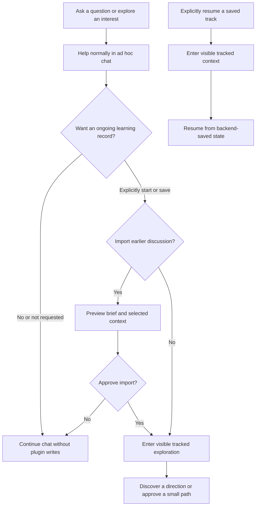
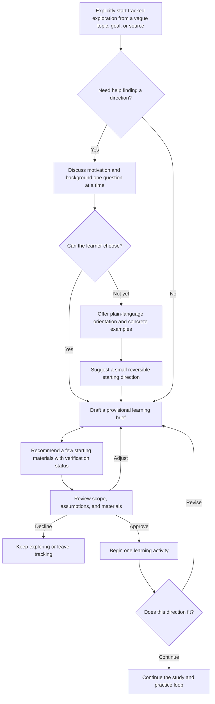
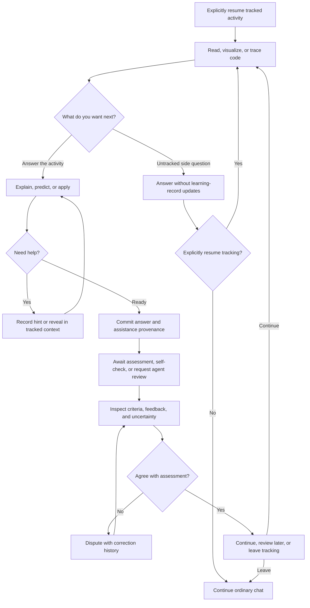

# Proposed learner flows

Status: proposed product behavior, not runtime-tested plugin integration. Ordinary educational chat is ad hoc; explicit tracking opt-in precedes plugin persistence. Earlier standalone HTML/PNG diagrams omit this boundary and should not be treated as the current complete flow.

## 1. Choose whether to keep a learning record

This is a user decision, not a question that the agent must ask on every turn. An occasional offer may occur when continuing study becomes useful; a decline suppresses repeat offers in that conversation. Topic, depth, opening a workspace, and loading a skill do not authorize persistence. Normal Hermes conversation history still applies.

## 2. Discover a direction inside tracked exploration

The same discovery conversation can happen ad hoc, but only opted-in exploration is saved in the plugin. Persistence opt-in does not approve the proposed learning path. Discovery is not an examination, and uncertainty is valid. A clear goal/source can skip the interview. Ask for a suggested starting point without completing a questionnaire.

## 3. Study, ask side questions, and leave

A side question is not automatically an attempt. If the learner's intent is unclear, ask before recording evidence. Leaving stops new writes in that context without deleting or archiving the track. Existing committed records remain. A different chat stays ad hoc until explicitly resumed; another deliberately active workspace context is independent and labeled.

## Cross-client continuity

After explicit opt-in, committed exploration and activity context can resume in chat, desktop, or web. Switching clients is not automatic enrollment of unrelated conversations. Local unsubmitted drafts do not synchronize across devices. Messaging uses text alternatives; interactive diagrams live in the workspace. The backend rejects late mutations against exited tracking contexts.

## Acceptance scenarios

- **Ad hoc beginner:** "I am curious about distributed systems but know nothing about it." Help clarify direction and suggest materials without a plugin record. A decline of tracking does not cause repeated offers.
- **Promote selectively:** preview and approve selected discussion before saving it as discovery notes. Do not import the full conversation or grade earlier statements.
- **Tracked beginner:** explicitly start tracked exploration, then save unresolved questions and assumptions before a path is approved. Resume in another client and recheck direction after the first activity.
- **Exit:** ask "just explain this; don't track it," receive the explanation without progress updates, and explicitly resume if desired. Leaving does not erase prior data; late writes are rejected.
