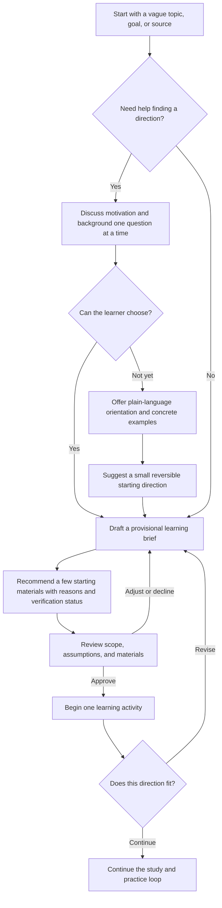
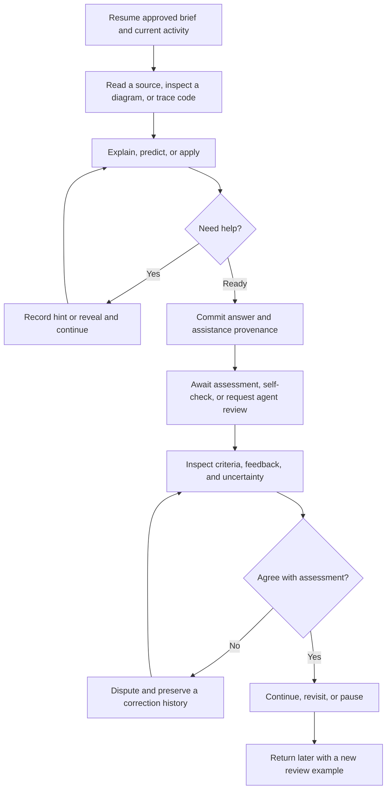

# Proposed learner flows

Status: product flows derived from requirements; not runtime-tested plugin behavior. Discovery precedes the earlier goal/source setup diagrams when the learner is unsure what to study.

## 1. Discover a direction

The learner can ask for a suggested starting point without completing a questionnaire. A speculative direction remains a proposal until explicitly accepted. Discovery is not an examination. A clear goal/source can skip the interview. The saved exploration is available in chat, desktop, and web before a track is active.

## 2. Study and practice

At any committed checkpoint, switch clients and resume the same server-owned record. Local unsubmitted drafts do not synchronize across devices. Text alternatives keep the activity usable in messaging; interactive diagrams live in the desktop/web workspace.

## Concrete acceptance scenario

A learner says "I am curious about distributed systems but know nothing about it." The agent explores what sparked the interest. If the learner cannot answer, it explains a few concrete situations and offers a provisional starting point. It proposes a small brief plus verified references or clearly unverified candidates, obtains approval, and begins an introductory activity. Afterward the learner can revise the direction. Pausing during discovery must preserve the unanswered question and assumptions without creating a mastery score or inventing consent.
