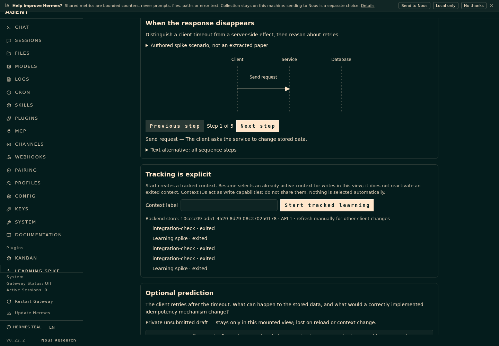
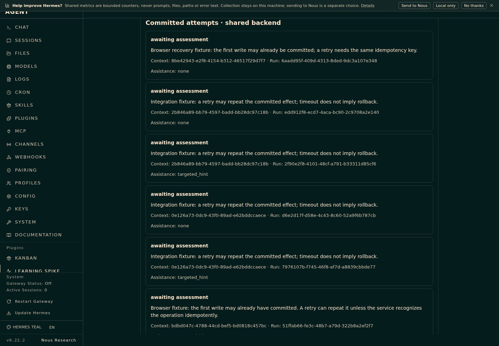
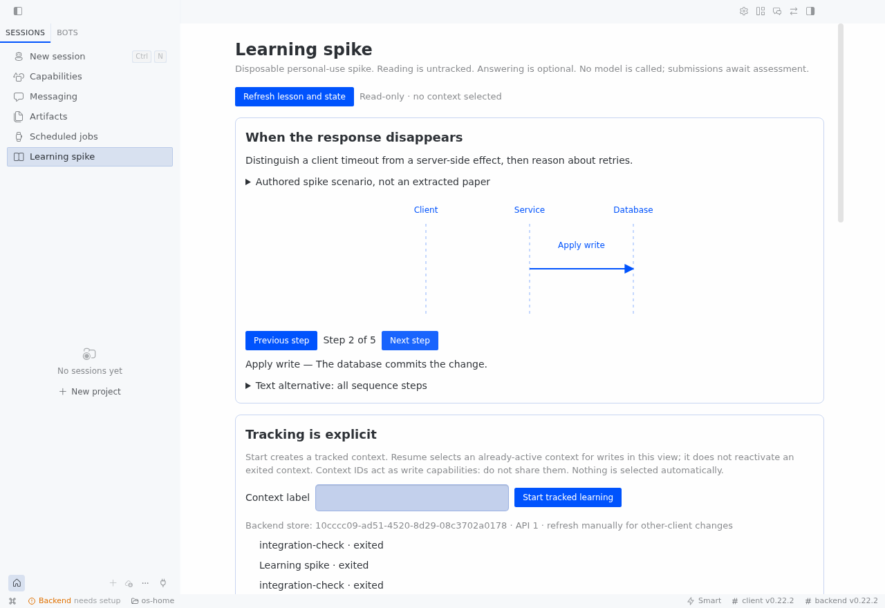

# Recorded spike evidence

Status: partial feasibility result. These notes distinguish executed checks from proposed/manual checks.

## Environment

- Hermes source revision: `d923a5eb487a17c0a68801bba9ef0f56c81040a8`.
- Real dashboard displayed version `0.22.2`.
- Python `3.14.7`, Node `24.18.0`.
- Clean child HOME plus HERMES_HOME, isolated loopback server, no copied model or messaging credentials, no lazy dependency installs.
- No changes/restarts to the daily Hermes app, gateway, or profile.

## Executed

- Ten stdlib unittest checks: the original four observed red/green store behaviors (ad hoc no records, persistence/assistance, retry versus deliberate repeat, and revoked-context writes), plus six regressions for proxy/redirect restrictions, relative source paths, and start-label errors. ResourceWarnings are treated as errors. The API regression imports FastAPI/Pydantic; the full ten-test suite also passed in a fresh venv with the exact declared CI dependencies installed.
- Six dependency-free Node checks exercise the real renderer with lightweight hook fixtures. They cover current-run refresh, lost new-run responses, frozen uncertain retry identity, exact committed readback, mismatched evidence, and malformed acknowledgments. Both renderer copies are checked identical; this is not a substitute for the actual host checks.
- Ten real-host integration assertions in [integration.json](integration.json). These use actual PluginManager registration, registered command handler, registry.dispatch, authenticated dashboard HTTP routes, and dashboard plugin discovery. They are not mock API responses.
- Registered five tools, one slash command, and both teaching/Humanizer-compatible skills. The host skill-view function can retrieve both bundled skills from a clean profile.
- Browser inspection of the actual Hermes web dashboard plugin: sequence rendered, Next step changed the step, explicit start issued a context, recorded hint survived submission, answer appeared as awaiting assessment, and Leave returned the view to read-only.
- Restarted only the owned isolated dashboard process after the review fixes and read back the exact same state, including all five fixture attempts committed before that restart. Prepare, serve, and the real registry checks used an explicitly relative Hermes source path.
- Exercised recovery in the real web UI: another client issued a new server run, Refresh reconciled it, and the UI submitted against that new run. A one-shot browser fault deliberately dropped the successful submission response after the real backend committed. Exact state readback cleared uncertainty, and Leave retained exactly one saved recovery attempt. See [recovery evidence](recovery.json).
- Both frontend files pass Node syntax checks. Desktop ESM does not require extra npm imports.

## Not established by these results

- Correct natural-language enrollment/consent for every chat, or a session-bound capability boundary. The spike currently uses context IDs issued by explicit UI/command entry.
- Actual model skill adherence or grading quality; no model was invoked for the fixture lesson.
- Actual messaging-channel delivery/tool use, remote deployment/proxy behavior, multi-device draft continuity, or all requirements in R0-R11.
- Full product readiness. Humanizer prose guidance is not an educational/security guarantee.

## Web screenshots

These are captures of the actual isolated Hermes dashboard, not standalone mockups. Only authored fixture answers and exited test contexts are shown.

## Desktop

The real Electron host loaded the current desktop adapter through the official SDK in a copied application distribution with fresh HOME, HERMES_HOME, XDG paths, and Electron user-data directory. It connected to the existing isolated loopback backend; no credentials from the daily installation were inherited.

Read-only mounting and Previous/Next navigation worked. The same store identity, contexts, and attempts were displayed; authenticated before/after reads showed no learning-state mutations. There were no visible plugin error alerts. The host's credential-free "Backend needs setup" indicator did not prevent the plugin reading its backend routes.

Parent verification compared the probe's installed `plugin.js` byte-for-byte with the repository adapter and inspected the screenshot. See [desktop evidence](desktop.json).

Desktop start/hint/submit/leave mutations remain manual/unverified. Messaging, model behavior, remote proxy deployment, and natural-language consent are still unverified. All owned Electron/Xvfb processes were stopped; cleanup recorded no live owned-group survivors. The separate isolated dashboard process remained healthy during this check. After final web/API verification, the parent stopped its own dashboard server too and confirmed the test port was closed. No daily desktop installation or restart occurred.

Launch used the existing Electron binary and a copied existing `apps/desktop/dist`, with loopback-only remote-debugging flags and a private Xvfb display. Its clean environment set `HERMES_DESKTOP_REMOTE_URL` to the test backend and read `HERMES_DESKTOP_REMOTE_TOKEN` from the private runtime token file. No token is published. The local headless test used `--no-sandbox`; this is not a recommendation for a production launch or untrusted content.
